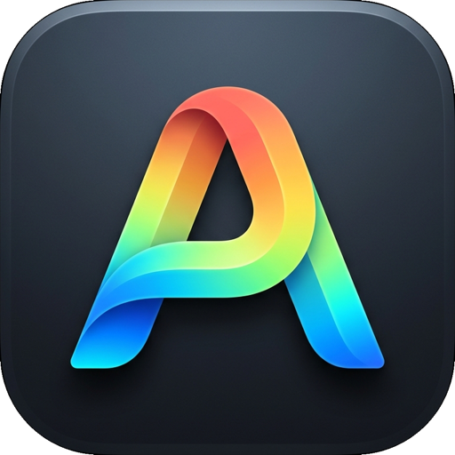

# AleClip for Android

<p align="center">
  
</p>

<p align="center">
  <b>The modern, colorful, and privacy-first clipboard manager for Android.</b><br>
  Native Kotlin &amp; Jetpack Compose with Material 3. 100% On-Device, Zero Telemetry.
</p>

<p align="center">
  
  
  
  
  
  
</p>

---

## Highlights

- **Instant Clipboard Ingest**: Captures copied text, links, color codes, and notes seamlessly when the app is active or via quick paste.
- **Accidental Deletion Protection & Trash Recovery**: Never lose an important note! Instant floating Undo snackbar notification (5-second recovery) and a dedicated Trash folder with one-tap restore.
- **System Share Sheet Integration**: Save text, links, and articles directly into AleClip from Chrome, WhatsApp, Twitter, Notes, and any Android app.
- **Quick Settings Tile**: Add the AleClip tile to your notification quick panel for instant 1-tap clipboard capture or launching the app.
- **Vibrant Spectrum Aesthetic (Zero Pink)**: Crafted using a custom radiant palette across Electric Cyan, Cobalt Azure, Neon Mint, Emerald Green, Electric Lime, and Sunburst Gold.
- **Smart Filter Categories**: Filter instantaneously across *All*, *Pinned*, *Text*, *Links*, *Colors*, *Images*, *Files*, and *Trash*.
- **Interactive Inspector & Editor**: Tap any clip to view full details, edit text notes, open URLs directly in your browser, or inspect color swatches.
- **Bi-Directional Backup & JSON Export**: Export your complete clip archive to JSON to migrate seamlessly between Android, iPhone, and Mac.
- **Full Bilingual Localization**: English and Turkish (Türkçe).
- **100% Privacy & Zero Telemetry**: Zero analytics, zero ad SDKs, zero cloud tracking. Complies with Google Play Data Safety specifications.

---

## Project Structure

```text
aleclip-android/
├── app/
│   ├── src/main/
│   │   ├── AndroidManifest.xml
│   │   ├── java/com/themanoftalent/aleclip/
│   │   │   ├── AleClipApp.kt                  # Application class
│   │   │   ├── MainActivity.kt                # Main Compose activity & resume listener
│   │   │   ├── ShareReceiverActivity.kt       # Android Share Sheet receiver
│   │   │   ├── model/
│   │   │   │   ├── ClipItem.kt                # Data model with formatting
│   │   │   │   └── ClipType.kt                # Type enum & zero-pink color mappings
│   │   │   ├── service/
│   │   │   │   ├── StorageService.kt          # JSON persistence, undo stack & trash
│   │   │   │   ├── ClipboardService.kt        # Android clipboard manager interop
│   │   │   │   └── QuickTileService.kt        # Quick Settings Tile service
│   │   │   └── ui/
│   │   │       ├── theme/                     # Material 3 & Spectrum colors
│   │   │       ├── components/                # WatermarkLogo & ClipRow card
│   │   │       ├── screens/                   # MainScreen, Detail, NewClip, Settings
│   │   │       └── viewmodel/                 # ClipViewModel
│   │   └── res/
│   │       ├── values/strings.xml             # English strings
│   │       ├── values-tr/strings.xml          # Turkish strings
│   │       └── mipmap-*/                      # App icons (mdpi to xxxhdpi)
│   └── build.gradle.kts                       # App Gradle config (Compose, SDK 34)
├── GooglePlay/
│   ├── METADATA.md                            # Play Store listing text & Data Safety
│   ├── PRIVACY_POLICY.md                      # Zero-telemetry Privacy Policy
│   ├── PLAY_STORE_SUBMISSION_GUIDE.md         # Play Console submission guide
│   └── ic_launcher_playstore_512.png          # 512x512 High-Res Play Store icon
└── .github/workflows/
    └── android-build.yml                      # CI/CD workflow building APK & AAB
```

---

## Google Play Store Submission

All Google Play Console metadata, descriptions, keywords, privacy declarations, and step-by-step instructions are ready:

- 📋 [**Play Store Metadata & Descriptions**](GooglePlay/METADATA.md)
- 🔒 [**Zero-Telemetry Privacy Policy**](GooglePlay/PRIVACY_POLICY.md)
- 🚀 [**Step-by-Step Play Store Submission Guide**](GooglePlay/PLAY_STORE_SUBMISSION_GUIDE.md)

---

## Building Locally

Open the project folder in **Android Studio**:
```bash
# Or run with Gradle on any machine:
gradle :app:bundleRelease :app:assembleRelease
```

---

## License

MIT License. Copyright © 2026 AleClip. Developed with passion by **themanoftalent**.
